# THIẾT KẾ CƠ SỞ DỮ LIỆU & SƠ ĐỒ QUAN HỆ THỰC THỂ (ERD)
## HỆ THỐNG WEBSITE HỖ TRỢ HỌC TỪ VỰNG TIẾNG ANH THÔNG MINH (CHUẨN B1 - OXFORD 3000)

* **Đơn vị thực hiện:** Nhóm 51 - Lớp K68CNTTF - Khoa Công nghệ Thông tin, Học viện Nông nghiệp Việt Nam
* **Giảng viên hướng dẫn:** ThS. Nguyễn Thị Huyền
* **Ngăn xếp công nghệ Backend:** NestJS (Modular Monolith), TypeORM (`synchronize: false`), **PostgreSQL 16+ (`pgvector/pgvector:pg16` Docker)**, **Redis + BullMQ**, Gemini AI API
* **Phiên bản tài liệu:** **v3.2 (FINAL)** — 19 Bảng thực thể + 14 ENUMs + 10 Triggers + Kiến trúc Redis
* **Tệp kỹ thuật đi kèm:** [schema_postgresql_v3.sql](schema_postgresql_v3.sql), [typeorm_entities_final.ts](typeorm_entities_final.ts), [DATABASE_ERD_v3.drawio](DATABASE_ERD_v3.drawio)
* **Ngày cập nhật tài liệu:** 22/11/2026

---

## 1. TỔNG QUAN KIẾN TRÚC CƠ SỞ DỮ LIỆU & REDIS

Hệ thống sử dụng **PostgreSQL 16+ chạy trong Docker (`pgvector/pgvector:pg16`, bảng mã `UTF-8`)** kết hợp **Redis + BullMQ** nhằm phân tách rõ ràng giữa dữ liệu bền vững (Persistent RDBMS + VectorDB) và dữ liệu tạm thời/hàng đợi (Ephemeral State):

### 1.1. Phân tách trách nhiệm PostgreSQL vs. Redis
* **PostgreSQL 16+ & `pgvector` (19 bảng – 14 ENUMs – 27 khóa ngoại – 10 Triggers `updated_at`):**
  * Lưu trữ toàn bộ dữ liệu nghiệp vụ bền vững, bảo đảm ACID, tìm kiếm ngữ nghĩa Vector (`pgvector` HNSW), tìm kiếm mờ (`pg_trgm` GIN) và tìm kiếm tiền tố (`LOWER(word) text_pattern_ops`).
  * Các bảng cốt lõi chuẩn hóa **3NF**. Một số cột/bảng tổng hợp (`decks.total_cards`, `study_sessions` counters, `daily_activities`, `user_streaks`) là *denormalized aggregate cache* có chủ đích, cập nhật nguyên tử trong cùng Transaction và có đối soát định kỳ. Riêng `user_vocabulary_progress.total_reviews` sử dụng cột sinh lưu trữ (`GENERATED ALWAYS AS (correct_count + incorrect_count) STORED`) để tuyệt đối không lệch số đếm.
* **Redis + BullMQ (Trạng thái tạm & Hàng đợi nền):**
  1. **Quên mật khẩu (FR-05) & Xác minh Email:** Lưu mã/token đã băm SHA-256 trên Redis với `TTL = 900s` (15 phút), dùng 1 lần duy nhất qua lệnh nguyên tử **`GETDEL`** (Redis 6.2+):
     * `auth:pwd_reset:token:<sha256>` (`TTL 900s`) — lưu `{ userId, email }`.
     * `auth:pwd_reset:user:<userId>` (`TTL 900s`) — vô hiệu hóa mã cũ ngay khi người dùng bấm gửi lại.
     * `auth:pwd_reset:attempts:<userId>` (`TTL 900s`) — giới hạn tối đa 5 lần nhập sai nếu dùng OTP 6 số.
     * Khi đặt lại mật khẩu thành công, thu hồi ngay toàn bộ `refresh_tokens` cũ (`is_revoked = TRUE`) trong cùng Transaction PostgreSQL.
  2. **Job Import tạm (Excel / DOCX / TXT):** Xử lý parse file, đối chiếu với kho Oxford (`vocabularies`) và trả preview trên Redis trước khi lưu vào `decks` + `deck_vocabularies`.
  3. **Hàng đợi gửi Email, Retry & Trạng thái Admin Online:** Quản lý bởi BullMQ trên Redis kèm logger ứng dụng.

### 1.2. Quy ước kiểu dữ liệu PostgreSQL 16
* **Khóa định danh:** `INT GENERATED ALWAYS AS IDENTITY` (4 bytes, ánh xạ trực tiếp sang `number` trong TypeScript/TypeORM).
* **Múi giờ & Thời gian:** Mọi mốc thời gian dùng `TIMESTAMPTZ` (UTC). Ngày địa phương tính theo múi giờ IANA chuẩn tại `users.timezone` (mặc định `'Asia/Ho_Chi_Minh'`). Trong `main.ts`, cấu hình `types.setTypeParser(1082, (v: string) => v)` (gói `pg`) để cột `DATE` luôn trả về chuỗi `'YYYY-MM-DD'`.
* **Account Linking & Email chuẩn hóa:** Cho phép tài khoản liên kết song song Local + Google (`password_hash IS NOT NULL OR google_id IS NOT NULL`) và ép `email = LOWER(email)`.

### 1.3. Tổng hợp 5 Phân hệ nghiệp vụ – 19 Bảng thực thể
1. **Phân hệ 1 – Người dùng & Xác thực (3 bảng):** `users`, `user_profiles`, `refresh_tokens` *(+ Redis `TTL + GETDEL` cho Quên mật khẩu / Xác minh Email)*.
2. **Phân hệ 2 – Từ điển, 239 Bài học lộ trình & Vector RAG (5 bảng):** `topics`, `vocabularies` *(3.813 bản ghi A1–B2 chuẩn Oxford, sẵn sàng C1–C2)*, `vocabulary_embeddings`, `decks`, `deck_vocabularies`.
3. **Phân hệ 3 – Tiến độ bài học, SM-2 / Leitner, Phiên học & Log (4 bảng):** `user_lesson_progress`, `user_vocabulary_progress`, `study_sessions`, `review_logs`.
4. **Phân hệ 4 – Trò chơi hóa, Thống kê & Nhắc nhở tự động (5 bảng):** `user_streaks`, `daily_activities`, `badges`, `user_badges`, `reminder_settings`.
5. **Phân hệ 5 – Hội thoại AI Level 2 & Hỗ trợ Admin (2 bảng):** `chat_conversations`, `chat_messages`.

---

## 2. SƠ ĐỒ QUAN HỆ THỰC THỂ (ERD - MERMAID DIAGRAM)

```mermaid
erDiagram
    USERS ||--o| USER_PROFILES : "has"
    USERS ||--o{ REFRESH_TOKENS : "owns"
    USERS ||--o| USER_STREAKS : "tracks"
    USERS ||--o| REMINDER_SETTINGS : "configures"
    USERS o|--o{ DECKS : "creates"
    USERS ||--o{ USER_LESSON_PROGRESS : "unlocks"
    USERS ||--o{ USER_VOCABULARY_PROGRESS : "records"
    USERS ||--o{ STUDY_SESSIONS : "performs"
    USERS ||--o{ REVIEW_LOGS : "submits"
    USERS ||--o{ DAILY_ACTIVITIES : "accumulates"
    USERS ||--o{ USER_BADGES : "earns"
    USERS ||--o{ CHAT_CONVERSATIONS : "initiates"
    USERS o|--o{ CHAT_CONVERSATIONS : "assigned_admin"
    USERS o|--o{ CHAT_MESSAGES : "sends"

    TOPICS ||--o{ VOCABULARIES : "categorizes"
    TOPICS o|--o{ DECKS : "groups_lessons"

    VOCABULARIES ||--o| VOCABULARY_EMBEDDINGS : "indexed_as_vector"

    DECKS ||--o{ DECK_VOCABULARIES : "contains"
    VOCABULARIES ||--o{ DECK_VOCABULARIES : "included_in"
    DECKS ||--o{ USER_LESSON_PROGRESS : "tracked_in"
    DECKS o|--o{ STUDY_SESSIONS : "practiced_in"

    STUDY_SESSIONS o|--o{ REVIEW_LOGS : "groups"

    VOCABULARIES ||--o{ USER_VOCABULARY_PROGRESS : "tracked_for"
    VOCABULARIES ||--o{ REVIEW_LOGS : "tested_in"
    VOCABULARIES o|--o{ CHAT_MESSAGES : "referenced_in"

    BADGES ||--o{ USER_BADGES : "awarded_to"
    CHAT_CONVERSATIONS ||--o{ CHAT_MESSAGES : "consists_of"

    USERS {
        int id PK
        varchar email UK "lowercase enforced"
        varchar password_hash "nullable; select:false"
        varchar full_name
        varchar timezone "Default Asia/Ho_Chi_Minh"
        varchar avatar_url
        enum role "learner, admin"
        enum auth_provider "local, google"
        varchar google_id UK "nullable"
        timestamptz email_verified_at "nullable"
        boolean is_active
        timestamptz created_at
        timestamptz updated_at
    }

    USER_PROFILES {
        int id PK
        int user_id FK,UK
        varchar phone
        date date_of_birth
        enum target_level "A1..C2"
        int daily_target_words
        boolean strict_unlock_enabled "Default TRUE"
        timestamptz updated_at
    }

    REFRESH_TOKENS {
        int id PK
        int user_id FK
        char token_hash UK "SHA-256 hex 64 chars"
        boolean is_revoked
        timestamptz expires_at
        timestamptz created_at
    }

    TOPICS {
        int id PK
        varchar name UK
        varchar slug UK
        text description
        varchar image_url
        timestamptz created_at
    }

    VOCABULARIES {
        int id PK
        varchar word
        enum cefr_level "A1..C2"
        varchar part_of_speech "14 Oxford POS tags"
        smallint sense_number "Default 1; homonyms"
        varchar phonetic
        smallint stress_syllable "nullable 1-based"
        varchar audio_url
        boolean is_active
        text vietnamese_meaning
        text example_en
        text example_vi
        int topic_id FK
        timestamptz created_at
        timestamptz updated_at
    }

    VOCABULARY_EMBEDDINGS {
        int vocabulary_id PK,FK
        vector embedding "pgvector(768) HNSW cosine"
        varchar embedding_model
        char content_hash "SHA-256 hex 64 chars"
        timestamptz updated_at
    }

    DECKS {
        int id PK
        int user_id FK "nullable for system_lesson"
        int topic_id FK "required for system_lesson"
        enum deck_type "system_lesson, custom_deck"
        int order_index "nullable; 1..N"
        varchar name
        text description
        boolean is_public
        enum cefr_level "A1..C2, all"
        int total_cards "15..20 for system_lesson"
        decimal pass_score_threshold "Default 80.00"
        timestamptz deleted_at "Soft delete custom_deck"
        timestamptz created_at
        timestamptz updated_at
    }

    DECK_VOCABULARIES {
        int deck_id PK,FK
        int vocabulary_id PK,FK
        int order_in_lesson "DEFERRABLE unique"
        timestamptz added_at
    }

    USER_LESSON_PROGRESS {
        int id PK
        int user_id FK
        int deck_id FK
        boolean acquisition_completed "Step 1 Flashcard done"
        boolean is_completed "Step 2 passed; never revoked"
        decimal best_score "0.00..100.00"
        decimal last_score "nullable"
        int attempts_count
        decimal pass_threshold_snapshot "nullable"
        timestamptz first_completed_at "nullable"
        timestamptz updated_at
    }

    USER_VOCABULARY_PROGRESS {
        int id PK
        int user_id FK
        int vocabulary_id FK
        smallint leitner_box "1..5 (Service spec002)"
        int repetitions
        decimal ease_factor "DECIMAL(8,4) >= 1.3000"
        int interval_days
        timestamptz last_reviewed_at
        date next_review_date "Partial Indexed"
        enum status "new, learning, reviewing, mastered"
        int correct_count
        int incorrect_count
        int total_reviews "GENERATED STORED"
        timestamptz created_at
        timestamptz updated_at
    }

    STUDY_SESSIONS {
        int id PK
        int user_id FK
        int deck_id FK "nullable"
        enum session_type "lesson_study, lesson_practice, sm2_review, mixed_quiz"
        timestamptz start_time
        timestamptz end_time "nullable"
        int total_questions
        int correct_answers
        decimal total_score "Includes 0.50 near_match"
        decimal score_percentage "0.00..100.00"
        int xp_earned
        timestamptz created_at
    }

    REVIEW_LOGS {
        int id PK
        int user_id FK
        int vocabulary_id FK
        int session_id FK "nullable"
        enum practice_mode "flashcard, multiple_choice, translation_typing, dictation_listening, cloze_test"
        text user_answer
        jsonb question_payload "4 options / context snapshot"
        enum grading_status "exact, near_match, phonetic_match, incorrect"
        decimal score "1.00, 0.50, 0.00"
        boolean is_correct "quality_rating >= 3"
        int damerau_levenshtein_distance "nullable"
        boolean soundex_matched "nullable"
        smallint quality_rating "0..5"
        int response_time_ms "5000ms / 12000ms SM-2"
        timestamptz created_at
    }

    USER_STREAKS {
        int id PK
        int user_id FK,UK
        int current_streak
        int longest_streak
        date last_study_date
        int freeze_streak_count
        timestamptz updated_at
    }

    DAILY_ACTIVITIES {
        int id PK
        int user_id FK
        date activity_date
        int words_learned
        int words_reviewed
        int questions_answered
        int correct_answers
        int study_seconds
        int total_xp
        int target_words_snapshot
        boolean is_target_met
        varchar timezone_used
        timestamptz created_at
    }

    BADGES {
        int id PK
        varchar code UK
        varchar name
        text description
        varchar icon_key "UI icon key or emoji"
        varchar icon_url "nullable custom image URL"
        enum condition_type "streak, words_count, perfect_score"
        int condition_value
        boolean is_active
    }

    USER_BADGES {
        int id PK
        int user_id FK
        int badge_id FK
        timestamptz earned_at
    }

    REMINDER_SETTINGS {
        int id PK
        int user_id FK,UK
        boolean email_reminder_enabled
        time reminder_time "Default 20:00:00"
        boolean is_warning_streak_enabled
        boolean is_inactivity_reminder_enabled
        timestamptz next_email_reminder_at_utc "nullable"
        timestamptz next_streak_warning_at_utc "nullable; 20:00 local"
        date last_email_reminded_date "nullable"
        date last_streak_warning_date "nullable"
        timestamptz last_inactivity_reminded_at "nullable"
        timestamptz updated_at
    }

    CHAT_CONVERSATIONS {
        int id PK
        int user_id FK
        enum type "ai_assistant, admin_support"
        enum status "open, closed"
        int assigned_admin_id FK "nullable"
        varchar title
        timestamptz created_at
        timestamptz updated_at
    }

    CHAT_MESSAGES {
        int id PK
        int conversation_id FK
        enum sender "user, assistant, admin"
        int sender_user_id FK "nullable"
        text content
        int related_vocabulary_id FK "nullable"
        enum feedback_type "grammar_check, explanation, example_generation, general"
        jsonb tool_calls "AI Level 2 Function Calling"
        int tokens_used "nullable"
        timestamptz read_at "nullable; admin_support"
        timestamptz created_at
    }
```

---

## 3. TỪ ĐIỂN DỮ LIỆU CHI TIẾT (19 BẢNG & 14 ENUMS)

### 3.0. Danh sách 14 kiểu ENUM PostgreSQL
`user_role_enum`, `auth_provider_enum`, `cefr_level_enum` (`A1..C2`), `deck_cefr_level_enum` (`A1..C2, all`), `deck_type_enum`, `progress_status_enum`, `session_type_enum` (`lesson_study`, `lesson_practice`, `sm2_review`, `mixed_quiz`), `practice_mode_enum`, `grading_status_enum`, `badge_condition_type_enum`, `chat_type_enum`, `chat_status_enum`, `chat_sender_enum`, `ai_feedback_type_enum`. *(Chi tiết DDL xem [schema_postgresql_v3.sql](schema_postgresql_v3.sql)).*

---

### 3.1. Phân hệ 1: Người dùng & Xác thực (3 bảng)

#### Bảng 1: `users`
| Tên cột | Kiểu dữ liệu | Ràng buộc | Mặc định | Giải thích nghiệp vụ |
| :--- | :--- | :--- | :--- | :--- |
| `id` | `INT` | `PRIMARY KEY, IDENTITY ALWAYS` | | Định danh duy nhất người dùng |
| `email` | `VARCHAR(191)` | `UNIQUE, NOT NULL, CHECK (= LOWER)` | | Địa chỉ Email chuẩn viết thường |
| `password_hash` | `VARCHAR(255)` | `NULLABLE` | `NULL` | Mật khẩu Bcrypt (`select: false` trong TypeORM) |
| `full_name` | `VARCHAR(100)` | `NOT NULL` | | Họ và tên hiển thị |
| `timezone` | `VARCHAR(64)` | `NOT NULL` | `'Asia/Ho_Chi_Minh'` | Múi giờ IANA chuẩn tính ngày học, SM-2, Streak và lịch nhắc |
| `avatar_url` | `VARCHAR(500)` | `NULLABLE` | `NULL` | Đường dẫn ảnh đại diện |
| `role` | `user_role_enum` | `NOT NULL` | `'learner'` | Vai trò (`learner`, `admin`) |
| `auth_provider` | `auth_provider_enum` | `NOT NULL` | `'local'` | Nguồn đăng ký (`local`, `google`) |
| `google_id` | `VARCHAR(100)` | `NULLABLE, UNIQUE` | `NULL` | Định danh Google OAuth2 (hỗ trợ liên kết song song với mật khẩu cục bộ) |
| `email_verified_at` | `TIMESTAMPTZ` | `NULLABLE` | `NULL` | Thời điểm xác minh email thành công qua Redis token |
| `is_active` | `BOOLEAN` | `NOT NULL` | `TRUE` | Trạng thái hoạt động tài khoản (`FALSE` = khóa) |
| `created_at` | `TIMESTAMPTZ` | `NOT NULL` | `CURRENT_TIMESTAMP` | Thời điểm đăng ký (UTC) |
| `updated_at` | `TIMESTAMPTZ` | `NOT NULL` | `CURRENT_TIMESTAMP` | Cập nhật tự động qua Trigger `trg_users_updated_at` |

#### Bảng 2: `user_profiles`
| Tên cột | Kiểu dữ liệu | Ràng buộc | Mặc định | Giải thích nghiệp vụ |
| :--- | :--- | :--- | :--- | :--- |
| `id` | `INT` | `PRIMARY KEY, IDENTITY ALWAYS` | | Khóa chính |
| `user_id` | `INT` | `UNIQUE, NOT NULL, FK -> users(id)` | | Quan hệ 1:1 tới `users` (`ON DELETE CASCADE`) |
| `phone` | `VARCHAR(20)` | `NULLABLE` | `NULL` | Số điện thoại liên hệ |
| `date_of_birth` | `DATE` | `NULLABLE` | `NULL` | Ngày sinh |
| `target_level` | `cefr_level_enum` | `NOT NULL` | `'B1'` | Cấp độ đầu ra mục tiêu (`A1..C2`) |
| `daily_target_words` | `INT` | `NOT NULL, CHECK (> 0)` | `15` | Chỉ tiêu số từ mới mỗi ngày |
| `strict_unlock_enabled` | `BOOLEAN` | `NOT NULL` | `TRUE` | Bật/tắt chế độ bắt buộc vượt ngưỡng bài $k-1$ mới mở khóa bài $k$ |
| `updated_at` | `TIMESTAMPTZ` | `NOT NULL` | `CURRENT_TIMESTAMP` | Cập nhật qua Trigger |

#### Bảng 3: `refresh_tokens`
| Tên cột | Kiểu dữ liệu | Ràng buộc | Mặc định | Giải thích nghiệp vụ |
| :--- | :--- | :--- | :--- | :--- |
| `id` | `INT` | `PRIMARY KEY, IDENTITY ALWAYS` | | Khóa chính |
| `user_id` | `INT` | `NOT NULL, FK -> users(id)` | | Chủ sở hữu Token (`ON DELETE CASCADE`) |
| `token_hash` | `CHAR(64)` | `UNIQUE, NOT NULL` | | SHA-256 hex cố định 64 ký tự |
| `is_revoked` | `BOOLEAN` | `NOT NULL` | `FALSE` | Thu hồi khi đăng xuất hoặc đổi/đặt lại mật khẩu |
| `expires_at` | `TIMESTAMPTZ` | `NOT NULL, CHECK (> created_at)` | | Thời điểm hết hạn |
| `created_at` | `TIMESTAMPTZ` | `NOT NULL` | `CURRENT_TIMESTAMP` | Thời điểm cấp phát |

---

### 3.2. Phân hệ 2: Từ điển, 239 Bài học lộ trình & Vector RAG (5 bảng)

#### Bảng 4: `topics`
| Tên cột | Kiểu dữ liệu | Ràng buộc | Mặc định | Giải thích nghiệp vụ |
| :--- | :--- | :--- | :--- | :--- |
| `id` | `INT` | `PRIMARY KEY, IDENTITY ALWAYS` | | Mã chủ đề (16 chủ đề chuẩn hóa) |
| `name` | `VARCHAR(100)` | `UNIQUE, NOT NULL` | | Tên chủ đề |
| `slug` | `VARCHAR(120)` | `UNIQUE, NOT NULL` | | URL slug tĩnh |
| `description` | `TEXT` | `NULLABLE` | `NULL` | Mô tả chủ đề |
| `image_url` | `VARCHAR(500)` | `NULLABLE` | `NULL` | Ảnh minh họa |
| `created_at` | `TIMESTAMPTZ` | `NOT NULL` | `CURRENT_TIMESTAMP` | Thời điểm tạo |

#### Bảng 5: `vocabularies`
Kho từ điển trung tâm nạp **3.813 từ vựng chuẩn hóa** từ `oxford_3000_vocabulary.xlsx` (`A1`: 1.074, `A2`: 995, `B1`: 908, `B2`: 836; sẵn sàng mở rộng `C1`, `C2`).

| Tên cột | Kiểu dữ liệu | Ràng buộc | Mặc định | Giải thích nghiệp vụ |
| :--- | :--- | :--- | :--- | :--- |
| `id` | `INT` | `PRIMARY KEY, IDENTITY ALWAYS` | | Khóa chính |
| `word` | `VARCHAR(100)` | `NOT NULL` | | Từ vựng tiếng Anh chuẩn hóa |
| `cefr_level` | `cefr_level_enum` | `NOT NULL` | | Cấp độ CEFR (`A1..C2`) |
| `part_of_speech` | `VARCHAR(30)` | `NOT NULL, CHECK (IN 14 nhãn Oxford)` | | `'n.'`, `'v.'`, `'adj.'`, `'adv.'`, `'prep.'`, `'conj.'`, `'pron.'`, `'det.'`, `'exclam.'`, `'number'`, `'modal v.'`, `'article'`, `'indefinite article.'`, `'infinitive marker'` |
| `sense_number` | `SMALLINT` | `NOT NULL, CHECK (>= 1)` | `1` | Phân biệt 4 cặp đồng âm/đa nghĩa hợp lệ (`lie`, `rest`, `rock`, `tear`) |
| `phonetic` | `VARCHAR(100)` | `NOT NULL` | | Phiên âm quốc tế chuẩn Oxford IPA `/.../` |
| `stress_syllable` | `SMALLINT` | `NULLABLE, CHECK (>= 1)` | `NULL` | Vị trí âm tiết mang trọng âm chính (bắt đầu từ 1, trích từ IPA) |
| `audio_url` | `VARCHAR(500)` | `NULLABLE` | `NULL` | Đường dẫn audio phát âm |
| `is_active` | `BOOLEAN` | `NOT NULL` | `TRUE` | Cờ soft-archive bảo toàn lịch sử học |
| `vietnamese_meaning` | `TEXT` | `NOT NULL` | | Nghĩa tiếng Việt chuẩn theo từ loại |
| `example_en` | `TEXT` | `NOT NULL` | | Câu ví dụ tiếng Anh độc lập |
| `example_vi` | `TEXT` | `NOT NULL` | | Bản dịch tiếng Việt tự nhiên |
| `topic_id` | `INT` | `NOT NULL, FK -> topics(id)` | | Khóa ngoại chủ đề (`ON DELETE RESTRICT`) |
| `created_at` | `TIMESTAMPTZ` | `NOT NULL` | `CURRENT_TIMESTAMP` | Thời điểm tạo |
| `updated_at` | `TIMESTAMPTZ` | `NOT NULL` | `CURRENT_TIMESTAMP` | Cập nhật qua Trigger |
| **UNIQUE KEY** | `(word, cefr_level, part_of_speech, sense_number)` | | | Hỗ trợ Seeder `ON CONFLICT DO UPDATE` an toàn |

#### Bảng 6: `vocabulary_embeddings` *(VectorDB `pgvector`)*
| Tên cột | Kiểu dữ liệu | Ràng buộc | Mặc định | Giải thích nghiệp vụ |
| :--- | :--- | :--- | :--- | :--- |
| `vocabulary_id` | `INT` | `PRIMARY KEY, FK -> vocabularies(id)` | | Quan hệ 1:1 với `vocabularies` (`ON DELETE CASCADE`) |
| `embedding` | `vector(768)` | `NOT NULL` | | Vector 768 chiều (`HNSW vector_cosine_ops`; `select: false` trong TypeORM) |
| `embedding_model` | `VARCHAR(100)` | `NOT NULL` | `'text-embedding-004'` | Tên model tạo embedding |
| `content_hash` | `CHAR(64)` | `NOT NULL` | | SHA-256 văn bản nguồn, chỉ tạo lại vector khi nội dung đổi |
| `updated_at` | `TIMESTAMPTZ` | `NOT NULL` | `CURRENT_TIMESTAMP` | Cập nhật qua Trigger |

#### Bảng 7: `decks`
Chứa **239 bài học lộ trình hệ thống** (`system_lesson`: `A1`: 68, `A2`: 61, `B1`: 56, `B2`: 54; **100% bài từ 15–20 từ** theo Phương án 1) và các bộ thẻ cá nhân (`custom_deck`) tạo từ kho Oxford (hỗ trợ Import Excel/DOCX/TXT qua BullMQ/Redis trả preview).

| Tên cột | Kiểu dữ liệu | Ràng buộc | Mặc định | Giải thích nghiệp vụ |
| :--- | :--- | :--- | :--- | :--- |
| `id` | `INT` | `PRIMARY KEY, IDENTITY ALWAYS` | | Khóa chính |
| `user_id` | `INT` | `NULLABLE, FK -> users(id)` | `NULL` | `NULL` cho `system_lesson`; `NOT NULL` cho `custom_deck` (`ON DELETE CASCADE`) |
| `topic_id` | `INT` | `NULLABLE, FK -> topics(id)` | `NULL` | Bắt buộc cho `system_lesson` (`ON DELETE RESTRICT`) |
| `deck_type` | `deck_type_enum` | `NOT NULL` | `'custom_deck'` | `'system_lesson'` hoặc `'custom_deck'` |
| `order_index` | `INT` | `NULLABLE, CHECK (>= 1)` | `NULL` | Thứ tự bài `1..N` trong từng `(topic_id, cefr_level)` |
| `name` | `VARCHAR(150)` | `NOT NULL` | | Tên bài học / bộ thẻ |
| `description` | `TEXT` | `NULLABLE` | `NULL` | Mô tả |
| `is_public` | `BOOLEAN` | `NOT NULL` | `TRUE` | Công khai hoặc riêng tư |
| `cefr_level` | `deck_cefr_level_enum` | `NOT NULL` | `'all'` | Cấp độ (`system_lesson` khác `'all'`) |
| `total_cards` | `INT` | `NOT NULL, CHECK (>= 0)` | `0` | Aggregate cache từ `deck_vocabularies` |
| `pass_score_threshold` | `DECIMAL(5,2)` | `NOT NULL, CHECK (0.00..100.00)` | `80.00` | Ngưỡng phần trăm mở khóa bài học (mặc định `80,00%`, có thể cấu hình) |
| `deleted_at` | `TIMESTAMPTZ` | `NULLABLE` | `NULL` | Soft-delete cho `custom_deck` (`system_lesson` luôn `NULL`) |
| `created_at` | `TIMESTAMPTZ` | `NOT NULL` | `CURRENT_TIMESTAMP` | Thời điểm tạo |
| `updated_at` | `TIMESTAMPTZ` | `NOT NULL` | `CURRENT_TIMESTAMP` | Cập nhật qua Trigger |
| **PARTIAL UNIQUE** | `(topic_id, cefr_level, order_index)` | `WHERE deck_type = 'system_lesson' AND deleted_at IS NULL` | | Chống trùng thứ tự bài hệ thống |

#### Bảng 8: `deck_vocabularies`
| Tên cột | Kiểu dữ liệu | Ràng buộc | Mặc định | Giải thích nghiệp vụ |
| :--- | :--- | :--- | :--- | :--- |
| `deck_id` | `INT` | `NOT NULL, FK -> decks(id)` | | Mã bài học (`ON DELETE CASCADE`) |
| `vocabulary_id` | `INT` | `NOT NULL, FK -> vocabularies(id)` | | Mã từ vựng (`ON DELETE CASCADE`) |
| `order_in_lesson` | `INT` | `NOT NULL, CHECK (>= 1)` | `1` | Thứ tự thẻ cố định trong Flashcard |
| `added_at` | `TIMESTAMPTZ` | `NOT NULL` | `CURRENT_TIMESTAMP` | Thời điểm thêm thẻ |
| **PRIMARY KEY** | `(deck_id, vocabulary_id)` | | | Chống trùng từ trong cùng bộ thẻ |
| **UNIQUE KEY** | `(deck_id, order_in_lesson)` | `DEFERRABLE INITIALLY DEFERRED` | | Cho phép kéo thả đổi thứ tự thẻ trong 1 transaction |

---

### 3.3. Phân hệ 3: Tiến độ bài học, SM-2 / Leitner, Phiên học & Log (4 bảng)

#### Bảng 9: `user_lesson_progress`
| Tên cột | Kiểu dữ liệu | Ràng buộc | Mặc định | Giải thích nghiệp vụ |
| :--- | :--- | :--- | :--- | :--- |
| `id` | `INT` | `PRIMARY KEY, IDENTITY ALWAYS` | | Khóa chính |
| `user_id` | `INT` | `NOT NULL, FK -> users(id)` | | Người học (`ON DELETE CASCADE`) |
| `deck_id` | `INT` | `NOT NULL, FK -> decks(id)` | | Bài học (`ON DELETE CASCADE`) |
| `acquisition_completed` | `BOOLEAN` | `NOT NULL` | `FALSE` | Đã hoàn thành Bước 1 (Học nạp Flashcard) |
| `is_completed` | `BOOLEAN` | `NOT NULL` | `FALSE` | Đã qua Bước 2 (`>= pass_threshold_snapshot`); không bao giờ thu hồi |
| `best_score` | `DECIMAL(5,2)` | `NOT NULL, CHECK (0.00..100.00)` | `0.00` | Điểm phần trăm cao nhất từng đạt |
| `last_score` | `DECIMAL(5,2)` | `NULLABLE, CHECK (0.00..100.00)` | `NULL` | Điểm của lần làm bài gần nhất |
| `attempts_count` | `INT` | `NOT NULL, CHECK (>= 0)` | `0` | Tổng số lượt làm Bước 2 |
| `pass_threshold_snapshot` | `DECIMAL(5,2)` | `NULLABLE, CHECK (0.00..100.00)` | `NULL` | Snapshot ngưỡng qua bài tại thời điểm học viên vượt qua lần đầu |
| `first_completed_at` | `TIMESTAMPTZ` | `NULLABLE` | `NULL` | Thời điểm hoàn thành lần đầu |
| `updated_at` | `TIMESTAMPTZ` | `NOT NULL` | `CURRENT_TIMESTAMP` | Cập nhật qua Trigger |
| **UNIQUE KEY** | `(user_id, deck_id)` | | | 1 dòng tiến độ duy nhất cho mỗi `(user, deck)` |

#### Bảng 10: `user_vocabulary_progress`
| Tên cột | Kiểu dữ liệu | Ràng buộc | Mặc định | Giải thích nghiệp vụ |
| :--- | :--- | :--- | :--- | :--- |
| `id` | `INT` | `PRIMARY KEY, IDENTITY ALWAYS` | | Khóa chính |
| `user_id` | `INT` | `NOT NULL, FK -> users(id)` | | Người học (`ON DELETE CASCADE`) |
| `vocabulary_id` | `INT` | `NOT NULL, FK -> vocabularies(id)` | | Từ vựng (`ON DELETE RESTRICT`; dùng `is_active=false` để archive) |
| `leitner_box` | `SMALLINT` | `NOT NULL, CHECK (1..5)` | `1` | Hộp Leitner ánh xạ 1-1 từ `repetitions` tại NestJS Service (`spec002`: $0\to 1, 1\to 2, 2\to 3, \{3,4\}\to 4, \ge 5\to 5$) |
| `repetitions` | `INT` | `NOT NULL, CHECK (>= 0)` | `0` | Số lượt nhớ liên tiếp $n$ ($q \ge 3$) |
| `ease_factor` | `DECIMAL(8,4)` | `NOT NULL, CHECK (>= 1.3000)` | `2.5000` | Hệ số dễ SM-2 lưu chính xác 4 số thập phân |
| `interval_days` | `INT` | `NOT NULL, CHECK (>= 0)` | `0` | Chu kỳ ngày ôn tập tiếp theo $I(n)$ |
| `last_reviewed_at` | `TIMESTAMPTZ` | `NULLABLE` | `NULL` | Thời điểm ôn gần nhất (UTC) |
| `next_review_date` | `DATE` | `NOT NULL` | | Ngày đến hạn ôn theo `users.timezone` (Partial Indexed) |
| `status` | `progress_status_enum` | `NOT NULL` | `'new'` | `'new'`, `'learning'`, `'reviewing'`, `'mastered'` (`box=5 AND interval>=21`) |
| `correct_count` | `INT` | `NOT NULL, CHECK (>= 0)` | `0` | Tổng số lượt đạt ($q \ge 3$) |
| `incorrect_count` | `INT` | `NOT NULL, CHECK (>= 0)` | `0` | Tổng số lượt quên/sai ($q < 3$) |
| `total_reviews` | `INT` | `GENERATED ALWAYS AS (correct_count + incorrect_count) STORED` | | Cột sinh tự động, không thể lệch số đếm |
| `created_at` | `TIMESTAMPTZ` | `NOT NULL` | `CURRENT_TIMESTAMP` | Thời điểm nạp từ lần đầu |
| `updated_at` | `TIMESTAMPTZ` | `NOT NULL` | `CURRENT_TIMESTAMP` | Cập nhật qua Trigger |
| **UNIQUE KEY** | `(user_id, vocabulary_id)` | | | Mỗi `(user, vocabulary)` chỉ có 1 bản ghi tiến trình |

#### Bảng 11: `study_sessions`
| Tên cột | Kiểu dữ liệu | Ràng buộc | Mặc định | Giải thích nghiệp vụ |
| :--- | :--- | :--- | :--- | :--- |
| `id` | `INT` | `PRIMARY KEY, IDENTITY ALWAYS` | | Khóa chính |
| `user_id` | `INT` | `NOT NULL, FK -> users(id)` | | Người học (`ON DELETE CASCADE`) |
| `deck_id` | `INT` | `NULLABLE, FK -> decks(id)` | `NULL` | Bài học / bộ thẻ (`ON DELETE SET NULL`) |
| `session_type` | `session_type_enum` | `NOT NULL` | `'lesson_practice'` | `'lesson_study'` (Bước 1), `'lesson_practice'` (Bước 2), `'sm2_review'`, `'mixed_quiz'` |
| `start_time` | `TIMESTAMPTZ` | `NOT NULL` | `CURRENT_TIMESTAMP` | Thời điểm bắt đầu |
| `end_time` | `TIMESTAMPTZ` | `NULLABLE, CHECK (>= start_time)` | `NULL` | Thời điểm kết thúc |
| `total_questions` | `INT` | `NOT NULL, CHECK (>= 0)` | `0` | Tổng số câu hỏi |
| `correct_answers` | `INT` | `NOT NULL, CHECK (<= total_questions)` | `0` | Số câu đạt (`is_correct = TRUE`) |
| `total_score` | `DECIMAL(6,2)` | `NOT NULL, CHECK (<= total_questions)` | `0.00` | Tổng điểm cộng cả câu gần đúng `0,50` |
| `score_percentage` | `DECIMAL(5,2)` | `NOT NULL, CHECK (0.00..100.00)` | `0.00` | Phần trăm điểm xét ngưỡng mở khóa |
| `xp_earned` | `INT` | `NOT NULL, CHECK (>= 0)` | `0` | Điểm XP kiếm được |
| `created_at` | `TIMESTAMPTZ` | `NOT NULL` | `CURRENT_TIMESTAMP` | Thời điểm tạo |

#### Bảng 12: `review_logs`
| Tên cột | Kiểu dữ liệu | Ràng buộc | Mặc định | Giải thích nghiệp vụ |
| :--- | :--- | :--- | :--- | :--- |
| `id` | `INT` | `PRIMARY KEY, IDENTITY ALWAYS` | | Khóa chính |
| `user_id` | `INT` | `NOT NULL, FK -> users(id)` | | Người thực hiện (`ON DELETE CASCADE`) |
| `vocabulary_id` | `INT` | `NOT NULL, FK -> vocabularies(id)` | | Từ vựng (`ON DELETE RESTRICT`) |
| `session_id` | `INT` | `NULLABLE, FK -> study_sessions(id)` | `NULL` | Phiên luyện tập (`ON DELETE SET NULL`) |
| `practice_mode` | `practice_mode_enum` | `NOT NULL` | | 5 chế độ luyện tập |
| `user_answer` | `TEXT` | `NULLABLE` | `NULL` | Đáp án thô học viên nhập/chọn |
| `question_payload` | `JSONB` | `NULLABLE` | `NULL` | Snapshot đề bài (ví dụ 4 phương án trắc nghiệm đã xáo trộn) để xem lại lịch sử |
| `grading_status` | `grading_status_enum` | `NOT NULL` | | `'exact'` (`1.00`), `'near_match'` (`0.50`), `'phonetic_match'` (`0.00`), `'incorrect'` (`0.00`) |
| `score` | `DECIMAL(3,2)` | `NOT NULL` | | Điểm số khớp 1-1 với `grading_status` |
| `is_correct` | `BOOLEAN` | `NOT NULL, CHECK (= (quality_rating >= 3))` | | Cờ nhị phân phục vụ index lọc lỗi sai |
| `damerau_levenshtein_distance` | `INT` | `NULLABLE, CHECK (>= 0)` | `NULL` | Khoảng cách Damerau-Levenshtein (tính tại NestJS Service) |
| `soundex_matched` | `BOOLEAN` | `NULLABLE` | `NULL` | Khớp âm vị Soundex/Metaphone |
| `quality_rating` | `SMALLINT` | `NOT NULL, CHECK (0..5)` | | Điểm chất lượng SM-2 |
| `response_time_ms` | `INT` | `NOT NULL, CHECK (>= 0)` | `0` | Thời gian phản xạ (ms) cho ngưỡng 5s / 12s |
| `created_at` | `TIMESTAMPTZ` | `NOT NULL` | `CURRENT_TIMESTAMP` | Thời điểm nộp đáp án |

---

### 3.4. Phân hệ 4: Trò chơi hóa, Thống kê & Nhắc nhở tự động (5 bảng)

#### Bảng 13: `user_streaks`
| Tên cột | Kiểu dữ liệu | Ràng buộc | Mặc định | Giải thích nghiệp vụ |
| :--- | :--- | :--- | :--- | :--- |
| `id` | `INT` | `PRIMARY KEY, IDENTITY ALWAYS` | | Khóa chính |
| `user_id` | `INT` | `UNIQUE, NOT NULL, FK -> users(id)` | | 1:1 tới `users` (`ON DELETE CASCADE`) |
| `current_streak` | `INT` | `NOT NULL, CHECK (>= 0)` | `0` | Chuỗi ngày học hiện tại |
| `longest_streak` | `INT` | `NOT NULL, CHECK (>= current_streak)` | `0` | Kỷ lục chuỗi ngày cao nhất |
| `last_study_date` | `DATE` | `NULLABLE` | `NULL` | Ngày địa phương gần nhất hoàn thành bài |
| `freeze_streak_count` | `INT` | `NOT NULL, CHECK (>= 0)` | `0` | Số lượt bảo toàn chuỗi |
| `updated_at` | `TIMESTAMPTZ` | `NOT NULL` | `CURRENT_TIMESTAMP` | Cập nhật qua Trigger |

#### Bảng 14: `daily_activities`
| Tên cột | Kiểu dữ liệu | Ràng buộc | Mặc định | Giải thích nghiệp vụ |
| :--- | :--- | :--- | :--- | :--- |
| `id` | `INT` | `PRIMARY KEY, IDENTITY ALWAYS` | | Khóa chính |
| `user_id` | `INT` | `NOT NULL, FK -> users(id)` | | Người học (`ON DELETE CASCADE`) |
| `activity_date` | `DATE` | `NOT NULL` | | Ngày hoạt động theo `users.timezone` |
| `words_learned` | `INT` | `NOT NULL, CHECK (>= 0)` | `0` | Số từ mới nạp trong ngày |
| `words_reviewed` | `INT` | `NOT NULL, CHECK (>= 0)` | `0` | Số lượt ôn tập trong ngày |
| `questions_answered` | `INT` | `NOT NULL, CHECK (>= 0)` | `0` | Tổng câu đã trả lời (phục vụ so sánh độ chính xác theo tuần) |
| `correct_answers` | `INT` | `NOT NULL, CHECK (<= questions_answered)` | `0` | Số câu đúng trong ngày |
| `study_seconds` | `INT` | `NOT NULL, CHECK (>= 0)` | `0` | Tổng thời gian học trong ngày (giây) để so sánh tuần |
| `total_xp` | `INT` | `NOT NULL, CHECK (>= 0)` | `0` | Tổng XP trong ngày |
| `target_words_snapshot` | `INT` | `NOT NULL, CHECK (> 0)` | | Snapshot chỉ tiêu từ mới tại ngày đó |
| `is_target_met` | `BOOLEAN` | `NOT NULL, CHECK (= (words_learned >= target_words_snapshot))` | `FALSE` | Đã đạt mục tiêu ngày hay chưa |
| `timezone_used` | `VARCHAR(64)` | `NOT NULL` | | Snapshot múi giờ IANA đã dùng |
| `created_at` | `TIMESTAMPTZ` | `NOT NULL` | `CURRENT_TIMESTAMP` | Thời điểm tạo |
| **UNIQUE KEY** | `(user_id, activity_date)` | | | Upsert nguyên tử qua `ON CONFLICT DO UPDATE` |

#### Bảng 15: `badges`
| Tên cột | Kiểu dữ liệu | Ràng buộc | Mặc định | Giải thích nghiệp vụ |
| :--- | :--- | :--- | :--- | :--- |
| `id` | `INT` | `PRIMARY KEY, IDENTITY ALWAYS` | | Khóa chính |
| `code` | `VARCHAR(50)` | `UNIQUE, NOT NULL` | | Mã cố định (`STREAK_7`, `WORDS_500`, `PERFECT_SCORE_10`) |
| `name` | `VARCHAR(100)` | `NOT NULL` | | Tên hiển thị |
| `description` | `TEXT` | `NOT NULL` | | Mô tả điều kiện |
| `icon_key` | `VARCHAR(100)` | `NOT NULL` | | Mã icon thư viện UI (Lucide/Emoji) hiển thị mặc định |
| `icon_url` | `VARCHAR(500)` | `NULLABLE` | `NULL` | Đường dẫn ảnh SVG/PNG tùy chọn (ưu tiên nếu khác `NULL`) |
| `condition_type` | `badge_condition_type_enum` | `NOT NULL` | | `'streak'` (số ngày liên tiếp), `'words_count'` (số từ `mastered`), `'perfect_score'` (số phiên đạt `100,00%` $\ge 15$ câu) |
| `condition_value` | `INT` | `NOT NULL, CHECK (> 0)` | | Ngưỡng giá trị theo đơn vị của `condition_type` |
| `is_active` | `BOOLEAN` | `NOT NULL` | `TRUE` | Cờ soft-archive |

#### Bảng 16: `user_badges`
| Tên cột | Kiểu dữ liệu | Ràng buộc | Mặc định | Giải thích nghiệp vụ |
| :--- | :--- | :--- | :--- | :--- |
| `id` | `INT` | `PRIMARY KEY, IDENTITY ALWAYS` | | Khóa chính |
| `user_id` | `INT` | `NOT NULL, FK -> users(id)` | | Người nhận thưởng (`ON DELETE CASCADE`) |
| `badge_id` | `INT` | `NOT NULL, FK -> badges(id)` | | Huy hiệu (`ON DELETE RESTRICT`) |
| `earned_at` | `TIMESTAMPTZ` | `NOT NULL` | `CURRENT_TIMESTAMP` | Thời điểm mở khóa |
| **UNIQUE KEY** | `(user_id, badge_id)` | | | Chống cấp trùng |

#### Bảng 17: `reminder_settings`
| Tên cột | Kiểu dữ liệu | Ràng buộc | Mặc định | Giải thích nghiệp vụ |
| :--- | :--- | :--- | :--- | :--- |
| `id` | `INT` | `PRIMARY KEY, IDENTITY ALWAYS` | | Khóa chính |
| `user_id` | `INT` | `UNIQUE, NOT NULL, FK -> users(id)` | | 1:1 tới `users` (`ON DELETE CASCADE`) |
| `email_reminder_enabled` | `BOOLEAN` | `NOT NULL` | `TRUE` | Bật/tắt email nhắc học hàng ngày |
| `reminder_time` | `TIME` | `NOT NULL` | `'20:00:00'` | Giờ nhắc học địa phương mong muốn |
| `is_warning_streak_enabled` | `BOOLEAN` | `NOT NULL` | `TRUE` | Bật/tắt cảnh báo mất chuỗi Streak (mặc định **`20:00`** theo Hiến pháp Điều IV) |
| `is_inactivity_reminder_enabled` | `BOOLEAN` | `NOT NULL` | `TRUE` | Bật/tắt email nhắc khi học viên lâu không quay lại học |
| `next_email_reminder_at_utc` | `TIMESTAMPTZ` | `NULLABLE` | `NULL` | Mốc UTC kế tiếp để Cron quét nhắc học |
| `next_streak_warning_at_utc` | `TIMESTAMPTZ` | `NULLABLE` | `NULL` | Mốc UTC kế tiếp để Cron quét cảnh báo mất Streak |
| `last_email_reminded_date` | `DATE` | `NULLABLE` | `NULL` | Chốt chặn compare-and-set chống gửi trùng nhắc học |
| `last_streak_warning_date` | `DATE` | `NULLABLE` | `NULL` | Chốt chặn compare-and-set chống gửi trùng cảnh báo Streak |
| `last_inactivity_reminded_at` | `TIMESTAMPTZ` | `NULLABLE` | `NULL` | Chống spam email nhắc "lâu không học" |
| `updated_at` | `TIMESTAMPTZ` | `NOT NULL` | `CURRENT_TIMESTAMP` | Cập nhật qua Trigger |

---

### 3.5. Phân hệ 5: Hội thoại (Trợ lý AI Level 2 & Hỗ trợ Admin) (2 bảng)

#### Bảng 18: `chat_conversations`
| Tên cột | Kiểu dữ liệu | Ràng buộc | Mặc định | Giải thích nghiệp vụ |
| :--- | :--- | :--- | :--- | :--- |
| `id` | `INT` | `PRIMARY KEY, IDENTITY ALWAYS` | | Khóa chính |
| `user_id` | `INT` | `NOT NULL, FK -> users(id)` | | Học viên mở hội thoại (`ON DELETE CASCADE`) |
| `type` | `chat_type_enum` | `NOT NULL` | `'ai_assistant'` | `'ai_assistant'` (Gemini AI) hoặc `'admin_support'` (hỗ trợ trực tuyến) |
| `status` | `chat_status_enum` | `NOT NULL` | `'open'` | `'open'` hoặc `'closed'` |
| `assigned_admin_id` | `INT` | `NULLABLE, FK -> users(id)` | `NULL` | Quản trị viên phụ trách (`ON DELETE SET NULL`; chỉ khác `NULL` khi `type = 'admin_support'`) |
| `title` | `VARCHAR(200)` | `NOT NULL` | `'Cuộc trò chuyện mới'` | Tiêu đề hội thoại |
| `created_at` | `TIMESTAMPTZ` | `NOT NULL` | `CURRENT_TIMESTAMP` | Thời điểm tạo |
| `updated_at` | `TIMESTAMPTZ` | `NOT NULL` | `CURRENT_TIMESTAMP` | Cập nhật qua Trigger |

#### Bảng 19: `chat_messages`
| Tên cột | Kiểu dữ liệu | Ràng buộc | Mặc định | Giải thích nghiệp vụ |
| :--- | :--- | :--- | :--- | :--- |
| `id` | `INT` | `PRIMARY KEY, IDENTITY ALWAYS` | | Khóa chính |
| `conversation_id` | `INT` | `NOT NULL, FK -> chat_conversations(id)` | | Cuộc hội thoại (`ON DELETE CASCADE`) |
| `sender` | `chat_sender_enum` | `NOT NULL` | | `'user'`, `'assistant'` (AI), hoặc `'admin'` |
| `sender_user_id` | `INT` | `NULLABLE, FK -> users(id)` | `NULL` | ID người gửi nếu là `user`/`admin`; luôn `NULL` nếu là `assistant` (`ON DELETE SET NULL`) |
| `content` | `TEXT` | `NOT NULL` | | Nội dung tin nhắn |
| `related_vocabulary_id` | `INT` | `NULLABLE, FK -> vocabularies(id)` | `NULL` | Từ vựng đính kèm làm ngữ cảnh RAG (`ON DELETE SET NULL`) |
| `feedback_type` | `ai_feedback_type_enum` | `NOT NULL` | `'general'` | `'grammar_check'`, `'explanation'`, `'example_generation'`, `'general'` |
| `tool_calls` | `JSONB` | `NULLABLE` | `NULL` | Vết Function Calling Level 2 (`lookup_vocabulary`, `get_user_study_status`, `generate_quick_quiz`) |
| `tokens_used` | `INT` | `NULLABLE, CHECK (>= 0)` | `NULL` | Số token Gemini tiêu thụ để kiểm soát hạn mức |
| `read_at` | `TIMESTAMPTZ` | `NULLABLE` | `NULL` | Trạng thái đã đọc cho luồng `admin_support` |
| `created_at` | `TIMESTAMPTZ` | `NOT NULL` | `CURRENT_TIMESTAMP` | Thời điểm gửi (UTC) |

---

## 4. TÓM TẮT RÀNG BUỘC, CHỈ MỤC & TRIỂN KHAI

* **Toàn bộ DDL khởi tạo (Extensions, 14 ENUMs, 19 bảng, 27 khóa ngoại, 39 `CHECK` constraints, 25 Index chuyên biệt và 10 Trigger `updated_at`):** Xem chi tiết tại [schema_postgresql_v3.sql](schema_postgresql_v3.sql).
* **Ánh xạ mã nguồn TypeORM (NestJS, `synchronize: false`, `DecimalTransformer`, `VectorTransformer`, `Relation<>`, `select: false`):** Xem chi tiết tại [typeorm_entities_final.ts](typeorm_entities_final.ts).
* **Sơ đồ chỉnh sửa trực quan trên draw.io:** Mở tệp [DATABASE_ERD_v3.drawio](DATABASE_ERD_v3.drawio) trực tiếp trên `https://app.diagrams.net`.
