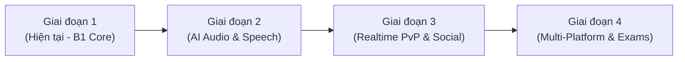

# TÀI LIỆU ĐẶC TẢ YÊU CẦU PHẦN MỀM (SRS - SOFTWARE REQUIREMENTS SPECIFICATION)
## HỆ THỐNG WEBSITE HỖ TRỢ HỌC VÀ LUYỆN TỪ VỰNG TIẾNG ANH THÔNG MINH (OXFORD 3000 - CHUẨN B1)

* **Tên đề tài:** Xây dựng website hỗ trợ học và luyện từ vựng tiếng Anh theo phương pháp lặp lại ngắt quãng (Spaced Repetition) kết hợp Trợ lý ảo AI
* **Đơn vị thực hiện:** Nhóm 51 - Lớp K68CNTTF - Khoa Công nghệ Thông tin, Học viện Nông nghiệp Việt Nam
* **Giảng viên hướng dẫn:** ThS. Nguyễn Thị Huyền
* **Ngăn xếp công nghệ:**
  * **Frontend:** React / Next.js (App Router), TypeScript, TailwindCSS, Shadcn UI, Web Speech API
  * **Backend:** NestJS (Modular Monolith Architecture), TypeORM, PostgreSQL 16+ (`pgvector/pgvector:pg16` Docker), Redis (Cache & BullMQ Job Queue), Gemini AI API
* **Phiên bản tài liệu:** 1.2 (Cập nhật PostgreSQL 16 + `pgvector` & 19 bảng: 22/11/2026)

---

## MỤC LỤC
1. [GIỚI THIỆU TỔNG QUAN & PHẠM VI HỆ THỐNG](#1-giới-thiệu-tổng-quan--phạm-vi-hệ-thống)
2. [CÁC TÁC NHÂN HỆ THỐNG (ACTORS)](#2-các-tác-nhân-hệ-thống-actors)
3. [YÊU CẦU CHỨC NĂNG (FUNCTIONAL REQUIREMENTS - FR)](#3-yêu-cầu-chức-năng-functional-requirements---fr)
   * 3.1. Phân hệ 1: Quản lý người dùng & Xác thực (User Management & Auth)
   * 3.2. Phân hệ 2: Quản lý Chủ đề, Lộ trình & Bộ thẻ học (Topics, Lessons & Decks)
   * 3.3. Phân hệ 3: Luyện tập thông minh & Thuật toán Spaced Repetition (SRS SM-2 & Leitner)
   * 3.4. Phân hệ 4: Chấm điểm tương thích & Phân tích sai số (Levenshtein & Soundex)
   * 3.5. Phân hệ 5: Trợ lý ảo AI mức MVP & Kiểm soát Token (Gemini AI Tutor)
   * 3.6. Phân hệ 6: Trò chơi hóa, Thống kê tiến độ & Nhắc nhở (Gamification & Retention)
   * 3.7. Phân hệ 7: Quản trị hệ thống (Admin Portal)
4. [YÊU CẦU PHI CHỨC NĂNG (NON-FUNCTIONAL REQUIREMENTS - NFR)](#4-yêu-cầu-phi-chức-năng-non-functional-requirements---nfr)
   * 4.1. Hiệu năng & Tải (Performance & Scalability)
   * 4.2. Bảo mật & An toàn dữ liệu (Security & Data Protection)
   * 4.3. Độ tin cậy & Tính sẵn sàng (Reliability & Availability)
   * 4.4. Khả năng sử dụng & Trải nghiệm người dùng (Usability & UX)
   * 4.5. Khả năng bảo trì & Mở rộng mã nguồn (Maintainability & Extensibility)
   * 4.6. Tính tương thích & Chuẩn hóa (Compatibility & Compliance)
5. [LẬP BẢN ĐỒ TƯƠNG THÍCH CƠ SỞ DỮ LIỆU](#5-lập-bản-đồ-tương-thích-cơ-sở-dữ-liệu)
6. [HƯỚNG PHÁT TRIỂN & MỞ RỘNG TRONG TƯƠNG LAI (FUTURE ROADMAP)](#6-hướng-phát-triển--mở-rộng-trong-tương-lai-future-roadmap)

---

## 1. GIỚI THIỆU TỔNG QUAN & PHẠM VI HỆ THỐNG

### 1.1. Bối cảnh & Vấn đề thực tiễn
Trong quá trình học ngoại ngữ, đặc biệt là tiếng Anh để đạt chuẩn đầu ra B1 (theo Khung tham chiếu Châu Âu CEFR), người học thường gặp phải các rào cản lớn:
* **Hội chứng "Học trước quên sau":** Học từ vựng theo cách truyền thống (nhồi nhét danh sách từ) không dựa trên đường cong lãng quên của Ebbinghaus, dẫn đến tỷ lệ rơi rụng từ vựng lên đến 80% sau 48 giờ.
* **Học từ đơn lẻ, sai ngữ cảnh & loại từ:** Nhiều từ vựng tiếng Anh biến đổi nghĩa phụ thuộc vào từ loại (*noun*, *verb*, *adjective*), người học không nắm được câu ví dụ ngữ cảnh cụ thể.
* **Thiếu phản hồi chi tiết khi gõ sai:** Khi người học gõ sai một từ, các hệ thống trắc nghiệm thông thường chỉ báo Đúng/Sai mà không chỉ ra người học sai do nhầm lẫn âm thanh đồng âm (*phonetic spelling*) hay nhầm ký tự (*typo*).
* **Thiếu người đồng hành hướng dẫn tương tác 24/7:** Chi phí để có gia sư kèm cặp giải thích ngữ pháp và tạo tình huống đàm thoại ngữ cảnh rất cao.

### 1.2. Mục tiêu hệ thống
Xây dựng một hệ thống Website hiện đại, thông minh, tối ưu trải nghiệm học từ vựng tiếng Anh với các trụ cột công nghệ:
1. **Kho học liệu chuẩn hóa:** 3.813 từ vựng cốt lõi Oxford 3000 phân bổ từ A1 đến B2, chuẩn hóa 100% phiên âm IPA Oxford, câu ví dụ ngữ cảnh Anh – Việt và phân chia thành 16 chủ đề thực tế.
2. **Thuật toán Spaced Repetition (SM-2 & Hộp Leitner):** Tính toán chính xác thời điểm vàng cần ôn tập cho từng từ vựng của từng học viên, chuyển từ vựng từ trí nhớ ngắn hạn sang trí nhớ dài hạn.
3. **Chấm điểm thông minh với Levenshtein & Soundex:** Phân loại sai sót giúp người học nhận biết bản thân "gõ nhầm phím" hay "hiểu sai quy tắc chính tả phát âm".
4. **Trợ lý gia sư AI mức MVP (Gemini AI API):** Tích hợp AI ở mức MVP (Prompt Engineering) để gợi ý giải nghĩa theo ngữ cảnh, giải thích lỗi sai trực tiếp, hỏi đáp với gia sư AI và sửa câu cơ bản kèm kiểm soát hạn mức Token. (Hạ tầng CSDL sẵn sàng mở rộng lên Semantic RAG với `pgvector` ở giai đoạn sau).
5. **Cơ chế Gamification & Giữ chân học viên:** Chuỗi ngày học liên tục (Streak), Điểm kinh nghiệm (XP), Bảng xếp hạng hàng tuần, Hệ thống huy hiệu thành tích và Email nhắc nhở tự động định kỳ.

---

## 2. CÁC TÁC NHÂN HỆ THỐNG (ACTORS)

| Tác nhân (Actor) | Mô tả vai trò | Quyền hạn chính |
| :--- | :--- | :--- |
| **Người học (User / Learner)** | Tác nhân người dùng duy nhất phía học tập (gộp chung trước và sau đăng nhập, không tách riêng Guest) | Trước khi xác thực: Đăng ký tài khoản, Đăng nhập (cục bộ hoặc Google OAuth2), Khôi phục mật khẩu. Sau khi đăng nhập: Học theo lộ trình CEFR (A1–B2) hoặc chủ đề, tự tạo bộ thẻ Flashcard (Deck), thực hiện các phiên ôn tập SM-2 hàng ngày, tích lũy XP/Streak, xem dashboard tiến độ & đánh giá học tập, trò chuyện hỏi đáp với Trợ lý AI. |
| **Quản trị viên (Admin)** | Người quản lý vận hành toàn bộ hệ thống | Đăng nhập/Đăng xuất cổng quản trị, quản trị kho từ vựng gốc (thêm/sửa/xóa từ vựng, chủ đề), quản lý tài khoản người dùng, cấu hình dịch vụ AI và giám sát lượng tiêu thụ API Token, thống kê báo cáo hệ thống. |
| **Dịch vụ AI bên ngoài (Service AI Provider)** | Nền tảng dịch vụ trí tuệ nhân tạo bên thứ ba | Google Gemini API / OpenAI API xử lý gợi ý giải nghĩa và hỏi đáp với Gia sư AI. *(Các dịch vụ hạ tầng phụ trợ khác như Google OAuth2, Email SMTP/Resend, Web Speech API được mô tả trong luồng đặc tả chi tiết).* |

---

## 3. YÊU CẦU CHỨC NĂNG (FUNCTIONAL REQUIREMENTS - FR)

### 3.1. Phân hệ 1: Quản lý người dùng & Xác thực (Identity & Access Management)

* **FR-01: Đăng ký & Đăng nhập cục bộ (Local Authentication):**
  * Cho phép người dùng đăng ký tài khoản bằng Email, Mật khẩu và Họ tên.
  * Mật khẩu phải được mã hóa một chiều bằng thuật toán `Bcrypt` (độ dài Salt $\ge 10$) trước khi lưu vào CSDL.
  * Đăng nhập thành công trả về cặp mã `Access Token` (JWT, hạn ngắn: 15–30 phút) và `Refresh Token` (hạn dài: 7–30 ngày, lưu dạng băm SHA-256 trong bảng `refresh_tokens`).
* **FR-02: Đăng nhập một chạm qua Google OAuth2:**
  * Cho phép người dùng đăng nhập/đăng ký tức thì qua tài khoản Google.
  * Tự động đồng bộ hóa Email, Họ tên và Ảnh đại diện từ Google Profile vào bảng `users`.
* **FR-03: Quản lý phiên làm việc & Thu hồi Token (Token Rotation & Revocation):**
  * Hỗ trợ cơ chế tự động làm mới `Access Token` thông qua `Refresh Token` mà không gián đoạn trải nghiệm người dùng.
  * Khi người dùng Đăng xuất (Logout) hoặc đổi mật khẩu, hệ thống đánh dấu `is_revoked = TRUE` trên `refresh_tokens`.
* **FR-04: Quản lý hồ sơ cá nhân & Thiết lập mục tiêu học tập:**
  * Cho phép học viên cập nhật thông tin cá nhân (ảnh đại diện, số điện thoại, ngày sinh).
  * Cho phép thiết lập Cấp độ mục tiêu (`A1`, `A2`, `B1`, `B2`) và Chỉ tiêu số từ mới học mỗi ngày (mặc định 15 từ, cho phép tùy chỉnh từ 5 đến 50 từ/ngày).
* **FR-05: Khôi phục mật khẩu & Xác minh Email (Forgot/Reset Password qua Redis):**
  * Gửi email xác thực chứa mã OTP hoặc đường dẫn bảo mật lưu tạm trên **Redis** (băm SHA-256, `TTL = 900 giây = 15 phút`, dùng 1 lần qua lệnh nguyên tử `GETDEL`, tự vô hiệu hóa mã cũ khi gửi lại và giới hạn tối đa 5 lần nhập sai nếu dùng OTP).
  * Khi đặt lại mật khẩu thành công, tự động thu hồi toàn bộ phiên đăng nhập cũ (`refresh_tokens.is_revoked = TRUE`) trong cùng Transaction.

---

### 3.2. Phân hệ 2: Quản lý Chủ đề, Lộ trình & Bộ thẻ học (Topics, Lessons & Decks)

* **FR-06: Khám phá từ vựng theo 16 chủ đề & Xem chi tiết học liệu (Topic Exploration & Vocabulary Details):**
  * *(Lưu ý phạm vi: Hệ thống hiện tại không triển khai module Tra cứu từ điển độc lập mà tập trung tổ chức học liệu theo chủ đề và bài học lộ trình).*
  * **Khám phá theo 16 Chủ đề chuẩn:** Duyệt từ vựng trong kho **3.813 từ vựng chuẩn hóa Oxford 3000** (`A1`: 1.074, `A2`: 995, `B1`: 908, `B2`: 836; lọc `is_active = TRUE`) theo danh mục 16 chủ đề ngữ cảnh (*People & Relationships*, *Food & Health*, *Business & Workplace*, *Science & Technology*...) phân bổ trên 32 nhóm `(cấp độ, chủ đề)`. Hiển thị số lượng từ và thanh tiến độ hoàn thành của học viên trên từng chủ đề.
  * **Chi tiết học liệu chuẩn hóa:** Hiển thị đầy đủ 9 trường thông tin trong thẻ học/bài học: Mặt chữ, Cấp độ CEFR, Từ loại (14 nhãn chuẩn Oxford), Phiên âm IPA chuẩn Oxford, Nút phát âm âm thanh (Audio pronunciation UK/US), Nghĩa tiếng Việt chính xác, Câu ví dụ tiếng Anh độc lập theo từng từ loại (không dùng chung câu giữa các từ loại khác nhau), Bản dịch nghĩa tiếng Việt của ví dụ và Chủ đề liên quan.
* **FR-07: Bài học lộ trình chuẩn của hệ thống & Quy trình học 2 bước (System Lessons & Unlock Gate $\ge 80\%$):**
  * Cung cấp **239 bài học lộ trình hệ thống** (`deck_type = 'system_lesson'`) chia đều theo từng nhóm `(cấp độ, chủ đề)` (`A1`: 68, `A2`: 61, `B1`: 56, `B2`: 54), đảm bảo **100% bài học có từ 15 đến 20 từ** (15–18 từ/bài, bài cuối tối đa 20 từ), cố định thứ tự bài (`order_index`) và thứ tự thẻ (`order_in_lesson`).
  * **Quy trình sư phạm 2 bước & Cổng mở khóa ($\ge 80\%$):**
    1. **Bước 1 – Học nạp (Flashcard Acquisition):** Học viên bắt buộc học qua 100% thẻ từ vựng trong bài theo thứ tự cố định (`user_lesson_progress.acquisition_completed = TRUE`) rồi mới được mở Bước 2.
    2. **Bước 2 – Học áp dụng & Mở khóa tuần tự:** Học viên làm bài kiểm tra áp dụng (tính cả điểm `0,50` cho câu gần đúng). Đạt từ **$\ge 80,00\%$** sẽ đánh dấu `is_completed = TRUE` và mở khóa bài học kế tiếp (`order_index + 1`). Nếu học viên làm lại bài đã qua với điểm thấp hơn $80\%$, hệ thống **không thu hồi** trạng thái hoàn thành và giữ nguyên `best_score`.
* **FR-08: Quản lý bộ thẻ học cá nhân (Custom Decks):**
  * Cho phép học viên tự tạo bộ thẻ học riêng (ví dụ: *"Từ vựng cần nhớ cho kỳ thi cuối kỳ"*).
  * Thêm/bớt các từ vựng từ kho học liệu hệ thống vào bộ thẻ cá nhân.
  * Cấu hình quyền riêng tư cho bộ thẻ: Công khai (`is_public = TRUE` để cộng đồng cùng học) hoặc Cá nhân (`FALSE`).

---

### 3.3. Phân hệ 3: Luyện tập thông minh & Thuật toán Spaced Repetition (SRS SM-2 & Leitner)

* **FR-09: Thuật toán tính lịch ôn tập lặp lại ngắt quãng (SuperMemo SM-2):**
  * Mỗi khi học viên trả lời một từ vựng, hệ thống tiếp nhận điểm chất lượng câu trả lời $q \in [0, 5]$ (quy đổi có xét ngưỡng tốc độ phản xạ `response_time_ms`: `5.000ms` / `12.000ms`) và tính toán lại các tham số trong bảng `user_vocabulary_progress` (`ease_factor` kiểu `DECIMAL(8,4)` tránh sai số dấu phẩy động):
    $$\text{Ease Factor (EF)}' = \max\Big(1.3000,\; EF + \big(0.1 - (5 - q) \times (0.08 + (5 - q) \times 0.02)\big)\Big)$$
    * **Nếu $q \ge 3$ (Nhớ thành công):**
      * `repetitions = repetitions + 1`.
      * Lần đúng đầu tiên ($n=1$): Khoảng cách $I(1) = 1$ ngày.
      * Lần đúng thứ hai ($n=2$): Khoảng cách $I(2) = 6$ ngày.
      * Lần đúng tiếp theo ($n > 2$): $I(n) = \text{round}(I(n-1) \times EF')$.
      * Ánh xạ cứng `leitner_box` theo `repetitions` (đồng bộ 1-1 với `CHECK` constraint): $n=0 \to 1$, $n=1 \to 2$, $n=2 \to 3$, $n \in \{3, 4\} \to 4$, $n \ge 5 \to 5$.
    * **Nếu $q < 3$ (Quên hoặc làm sai):**
      * Đặt lại `repetitions = 0`, chu kỳ `interval_days = 1` ngày, đưa về Hộp Leitner 1 (`leitner_box = 1`).
    * **Tính ngày ôn tập kế tiếp:** `next_review_date = user_local_today + interval_days` (tính theo múi giờ IANA chuẩn trong `users.timezone`).
* **FR-10: Quản lý 5 Hộp ghi nhớ Leitner trực quan:**
  * Trực quan hóa lộ trình làm chủ từ vựng của học viên theo ánh xạ 1-1 với `repetitions` ($n$):
    * *Hộp 1 ($n=0$ – Từ mới nạp / Hay quên)*
    * *Hộp 2 ($n=1$ – Bắt đầu nhớ)*
    * *Hộp 3 ($n=2$ – Khá nhớ)*
    * *Hộp 4 ($n \in \{3, 4\}$ – Gần thành thạo)*
    * *Hộp 5 ($n \ge 5$ – Thành thạo dài hạn).*
  * Trạng thái từ vựng chuyển thành `mastered` khi từ đạt Hộp 5 (`leitner_box = 5`) và chu kỳ ngắt quãng `interval_days >= 21`.
* **FR-11: Hàng đợi ôn tập hàng ngày (Daily Due Reviews Queue):**
  * Tự động lọc danh sách các từ đến hạn ôn tập có `user_id = $1 AND status IN ('learning', 'reviewing') AND next_review_date <= $user_local_today` (tính theo `users.timezone`).
  * Tối ưu truy vấn bằng **Chỉ mục có điều kiện (Partial Index)** của PostgreSQL: `idx_user_sm2_due (user_id, next_review_date) WHERE status IN ('learning', 'reviewing')`.
* **FR-12: Đa dạng hóa chế độ luyện tập (5 Practice Modes):**
  1. **Flashcard lật thẻ phản xạ:** Hiển thị từ theo đúng thứ tự `order_in_lesson` (Bước 1 Học nạp), phát âm âm thanh, lật mặt sau xem nghĩa & câu ví dụ; trong phiên ôn tập học viên tự đánh giá mức độ nhớ quy đổi $q \in [0..5]$.
  2. **Trắc nghiệm 4 lựa chọn (Multiple Choice):** Hiển thị nghĩa tiếng Việt / phát âm, yêu cầu chọn từ tiếng Anh đúng. Hệ thống tự động chọn **3 đáp án nhiễu (Distractors) cùng Cấp độ CEFR, cùng Loại từ (POS) và đang hoạt động (`is_active = TRUE`)** thông qua chỉ mục `idx_vocab_level_pos_active` rồi chọn ngẫu nhiên ở tầng Service.
  3. **Gõ từ theo nghĩa (Translation Typing):** Hiển thị nghĩa tiếng Việt và gợi ý ký tự đầu, học viên gõ từ tiếng Anh.
  4. **Nghe chép chính tả (Dictation Listening):** Phát audio phát âm bản xứ của từ vựng, học viên nghe và gõ lại đúng chính tả (phân biệt riêng lỗi *"Đúng âm vị – Sai chính tả"*).
  5. **Điền khuyết câu ví dụ ngữ cảnh (Cloze Test):** Hiển thị câu ví dụ tiếng Anh chuẩn bị ẩn từ khóa chính, học viên dựa vào ngữ cảnh câu và bản dịch tiếng Việt để điền từ đúng dạng.
* **FR-13: Quản lý phiên học tập trung (Study Sessions):**
  * Phân loại rõ 3 hình thức phiên trong `study_sessions.session_type`: Học áp dụng bài học (`lesson_practice`), Ôn tập SM-2 (`sm2_review`), và Kiểm tra tổng hợp phân tầng (`mixed_quiz` – Stratified Sampling).
  * Ghi nhận bắt đầu/kết thúc phiên (`start_time`, `end_time`), tổng số câu (`total_questions`), số câu đạt (`correct_answers`), **tổng điểm có tính câu gần đúng `0,50` (`total_score`)**, **tỷ lệ phần trăm (`score_percentage`)** để xét cổng mở khóa $\ge 80,00\%$, và điểm XP đạt được (`xp_earned`).

---

### 3.4. Phân hệ 4: Chấm điểm tương thích & Phân tích sai số (Damerau-Levenshtein & Soundex)

* **FR-14: Đo khoảng cách Damerau-Levenshtein & Chấm điểm "Gần đúng" (`0,50` điểm):**
  * Khi học viên nộp câu trả lời gõ từ, tầng Service (NestJS) tính toán khoảng cách **Damerau-Levenshtein** (hỗ trợ nhận diện phép hoán vị 2 ký tự liền kề trên từ $\ge 3$ ký tự, ví dụ `peopel` $\rightarrow$ `people` có khoảng cách = 1) và lưu vào `review_logs.damerau_levenshtein_distance`.
  * Phân loại chuẩn 4 trạng thái chấm điểm (`grading_status`) gắn liền với thang điểm `score` (`1.00 / 0.50 / 0.00`):
    * **`exact` (`1,00` điểm):** Trùng khớp chính xác đáp án.
    * **`near_match` (`0,50` điểm – Gần đúng):** Sai lỗi chính tả nhỏ hoặc hoán vị 2 ký tự liền kề trong ngưỡng cho phép $\rightarrow$ cộng `0,50` điểm vào `study_sessions.total_score` để xét tỷ lệ qua bài $\ge 80\%$ (ví dụ `13,5 / 16 = 84,38%`), hiển thị cảnh báo lỗi Typo và quy đổi mức $q$ phù hợp cho SM-2.
    * **`phonetic_match` (`0,00` điểm):** Đúng âm vị nhưng sai chính tả (xem FR-15).
    * **`incorrect` (`0,00` điểm):** Sai hoàn toàn.
* **FR-15: Phân tích đồng âm chính tả (Soundex / Metaphone Analysis):**
  * Chuyển đổi chuỗi nhập của học viên và từ vựng chuẩn sang mã ngữ âm Soundex / Double Metaphone.
  * Nếu mã phát âm trùng khớp nhưng viết sai chính tả (đặc biệt trong bài Nghe chép chính tả, ví dụ: gõ `cent` thay vì `scent`, `knew` thay vì `new`, `there` thay vì `their`):
    * Ghi nhận `soundex_matched = TRUE`, `grading_status = 'phonetic_match'`, `score = 0.00` vào bảng `review_logs`.
    * Phản hồi thông minh: *"Đúng âm vị – Sai chính tả: Bạn đã nắm đúng cách phát âm từ này, nhưng đang nhầm lẫn quy tắc viết chính tả"*.
* **FR-16: Ghi vết chi tiết từng lượt trả lời (Review Logging):**
  * Toàn bộ lịch sử trả lời được ghi nhận vào `review_logs` kèm `session_id`, `practice_mode`, `user_answer`, `grading_status`, `score`, `damerau_levenshtein_distance`, `soundex_matched`, `quality_rating`, và thời gian phản xạ mili-giây `response_time_ms` (phục vụ ngưỡng `5.000ms` / `12.000ms` của SM-2 và phân tích điểm yếu cá nhân).

---

### 3.5. Phân hệ 5: Trợ lý ảo AI mức MVP & Kiểm soát Token (Gemini AI Tutor)

* **FR-17: Trợ giảng AI gợi ý & giải thích lỗi sai (Mức MVP – Prompt Engineering):**
  * Khi học viên làm sai hoặc gặp từ khó trong phiên luyện tập, nút *"Xem gợi ý / Giải nghĩa"* hoặc *"Hỏi gia sư AI"* cho phép gửi ngữ cảnh bài tập (từ vựng, loại từ, đáp án người học nhập, lỗi Damerau-Levenshtein/Soundex) tới **Gemini AI API**.
  * Ở giai đoạn MVP, hệ thống sử dụng Prompt cấu trúc kèm dữ liệu từ vựng chuẩn trong CSDL để AI giải thích: Tại sao đáp án sai, cách phân biệt với từ dễ nhầm lẫn và mẹo ghi nhớ nhanh. *(Hạ tầng VectorDB `pgvector` trong `vocabulary_embeddings` được chuẩn bị sẵn cho giai đoạn mở rộng Semantic RAG).*
* **FR-18: Hỏi đáp với Gia sư AI (AI Tutor Chat – Mức MVP):**
  * Người học mở hội thoại trong `chat_conversations` (`type = 'ai_assistant'`; đồng thời bảng sẵn sàng mở rộng luồng hỗ trợ trực tuyến `'admin_support'`) để hỏi đáp tự do về từ vựng, ngữ cảnh sử dụng hoặc luyện hội thoại cơ bản theo chủ đề bài học.
  * *(Ghi chú mở rộng: Cột `chat_messages.tool_calls` kiểu `JSONB` đã được thiết kế sẵn để nâng cấp lên Function Calling đa công cụ ở giai đoạn sau).*
* **FR-19: Đặt câu và nhận xét ngữ pháp tức thì:**
  * Học viên nhập một câu tự sáng tác chứa từ mới vừa học; AI Gemini nhận xét câu văn (`feedback_type = 'grammar_check'`) và gợi ý 2–3 cách diễn đạt tự nhiên hơn.
* **FR-20: Kiểm soát hạn ngạch Token & Chống lạm dụng API:**
  * Mỗi lượt phản hồi từ Gemini API được ghi nhận số lượng `tokens_used` vào `chat_messages`.
  * Giới hạn số lượt hỏi AI / hạn mức Token mỗi ngày tùy theo cấu hình của Admin để bảo đảm ngân sách chi phí vận hành.

---

### 3.6. Phân hệ 6: Trò chơi hóa, Thống kê tiến độ & Nhắc nhở (Gamification & Retention)

* **FR-21: Chuỗi ngày học liên tục (Streak Mechanism):**
  * Mỗi ngày địa phương (tính theo `users.timezone`) học viên hoàn thành ít nhất 1 phiên học hoặc đạt chỉ tiêu từ mới, chuỗi `current_streak` tăng thêm 1.
  * Tự động cập nhật `longest_streak = GREATEST(longest_streak, current_streak)` khi kỷ lục bị phá.
  * Nếu qua ngày mới mà không học:
    * Nếu tài khoản có vật phẩm Đóng băng chuỗi (`freeze_streak_count > 0`): Hệ thống tự động tiêu hao 1 vật phẩm để cứu chuỗi và gửi thông báo chúc mừng.
    * Nếu không có vật phẩm bảo vệ: `current_streak` lùi về 0.
* **FR-22: Điểm kinh nghiệm (XP) & Bảng xếp hạng tuần (Leaderboard):**
  * Học viên tích lũy XP sau mỗi câu trả lời đúng và hoàn thành phiên học (`study_sessions.xp_earned`).
  * Bảng xếp hạng tuần tự động sắp xếp theo tổng XP đạt được trong tuần và bảng xếp hạng chuỗi Streak (`idx_leaderboard_streak`), làm mới tuần vào 00:00 sáng Thứ Hai hàng tuần.
* **FR-23: Hệ thống huy hiệu thành tích (Badges System):**
  * Tự động trao tặng các huy hiệu vinh danh đang hoạt động (`badges.is_active = TRUE`) khi học viên đạt cột mốc (`STREAK_7` - 7 ngày liên tục, `WORDS_500` - Đã nạp 500 từ, `PERFECT_SCORE_10` - Đạt điểm tuyệt đối).
  * Bản ghi lưu vào `user_badges` (với `badge_id ON DELETE RESTRICT` bảo toàn lịch sử thành tích).
* **FR-24: Biểu đồ nhiệt tiến độ học tập (Learning Activity Heatmap):**
  * Hiển thị biểu đồ hoạt động tương tự GitHub Contribution Graph dựa trên `daily_activities` (cập nhật nguyên tử qua `INSERT ... ON CONFLICT (user_id, activity_date) DO UPDATE`).
  * Lưu cố định `target_words_snapshot` và `timezone_used` cho từng ngày để việc thay đổi mục tiêu hoặc múi giờ sau này **không làm sai lệch trạng thái đạt mục tiêu (`is_target_met`) của các ngày quá khứ**.
* **FR-25: Hệ thống Email nhắc học & Cảnh báo mất chuỗi tự động (Automated Reminder Queue):**
  * Cho phép người dùng bật/tắt độc lập 2 luồng thông báo: **Email nhắc học hàng ngày** (`email_reminder_enabled`, cài đặt `reminder_time` mặc định `20:00`) và **Cảnh báo mất chuỗi Streak** (`is_warning_streak_enabled`, quét mặc định lúc **`20:00`** giờ địa phương theo `users.timezone` theo đúng Đề cương và Hiến pháp Điều IV).
  * **Cron Job & BullMQ Queue:** Sử dụng 2 mốc thời gian UTC tách biệt (`next_email_reminder_at_utc` và `next_streak_warning_at_utc`) cùng 2 chốt chặn *compare-and-set* độc lập (`last_email_reminded_date` và `last_streak_warning_date`) để hai loại thông báo không chặn lẫn nhau và chống gửi trùng tuyệt đối giữa nhiều worker.

---

### 3.7. Phân hệ 7: Quản trị hệ thống (Admin Portal)

* **FR-26: Quản trị học liệu, Kho từ điển & Danh mục huy hiệu (Vocabulary, Topics, Lessons & Badges Management):**
  * Hợp nhất toàn diện các tác vụ quản trị nội dung học tập vào một trung tâm quản lý học liệu thống nhất:
  * **Quản trị từ vựng & Soft-Archive:** Cho phép Admin thêm mới, chỉnh sửa phiên âm IPA, audio, nghĩa tiếng Việt, câu ví dụ; tự động tính lại `content_hash` và cập nhật vector `pgvector` trong `vocabulary_embeddings` khi nội dung thay đổi. Đối với từ vựng hoặc huy hiệu đã có người học (`ON DELETE RESTRICT`), hệ thống áp dụng cơ chế **Ẩn/Ngừng kích hoạt (`is_active = FALSE`)** thay vì xóa cứng để bảo toàn toàn vẹn lịch sử học tập.
  * **Quản trị phân loại & 239 Bài học lộ trình hệ thống:** Quản lý 16 chủ đề chuẩn (`topics`), điều phối thứ tự bài học (`order_index`) và thứ tự từ (`order_in_lesson`) trong các `system_lesson` (chuẩn 15–20 từ/bài).
  * **Nhập học liệu hàng loạt (Idempotent Batch Seed):** Hỗ trợ nạp tự động từ `oxford_3000_vocabulary.xlsx` (3.813 từ, khóa duy nhất 4 cột gồm `sense_number`) bằng `ON CONFLICT DO UPDATE` an toàn khi chạy lại nhiều lần.
* **FR-27: Quản lý người dùng & Phân quyền (User Moderation & Access Control):**
  * Xem danh sách toàn bộ học viên, ngày đăng ký, chuỗi ngày học hiện tại, tiến độ học tập và vai trò tài khoản (`role: learner | admin`).
  * Khóa (`is_active = FALSE`) hoặc mở khóa các tài khoản vi phạm tiêu chuẩn cộng đồng hoặc có dấu hiệu spam hệ thống.
* **FR-28: Báo cáo thống kê & Giám sát hệ thống / API (Analytics & System Monitoring):**
  * Báo cáo biểu đồ tổng số lượt ôn tập trong ngày/tuần/tháng, tỷ lệ người dùng quay lại (Retention Rate).
  * Thống kê và giám sát tổng số token tiêu thụ của Gemini API theo ngày/tháng để kiểm soát chi phí vận hành.

---

## 4. YÊU CẦU PHI CHỨC NĂNG (NON-FUNCTIONAL REQUIREMENTS - NFR)

### 4.1. Hiệu năng & Tải (Performance & Scalability)
* **NFR-01 (Thời gian phản hồi API):**
  * Các API truy vấn dữ liệu bài học/chủ đề, danh sách từ đến hạn ôn tập SM-2 (`GET /api/v1/reviews/due-today`) phải có thời gian phản hồi máy chủ $\le 100\text{ ms}$ (95th percentile $\le 50\text{ ms}$).
  * Các API tải danh sách từ vựng theo chủ đề và tiến độ học tập phản hồi $\le 150\text{ ms}$.
* **NFR-02 (Tối ưu hóa bộ nhớ CSDL & Shared Buffers):**
  * Khóa chính và khóa ngoại sử dụng `INTEGER` (4 bytes, dải giá trị tới 2,14 tỷ) tương thích tự nhiên với kiểu `number` của TypeScript, giúp bảng chỉ mục B-Tree gọn nhẹ hơn 50% so với `BIGINT`, cho phép nạp toàn bộ chỉ mục của 3.813 từ vựng và hàng triệu bản ghi tiến độ vào RAM của PostgreSQL Shared Buffers.
* **NFR-03 (Bộ đệm Caching với Redis):**
  * Danh mục từ điển cố định, thông tin các chủ đề và danh sách 16 bài học được lưu đệm trong Redis với thời gian sống (TTL) 24 giờ.
  * Tỉ lệ trúng bộ đệm (Cache Hit Ratio) cho các thao tác đọc tĩnh đạt $\ge 85\%$, giảm thiểu tối đa tải đọc tới PostgreSQL.
* **NFR-04 (Khả năng chịu tải đồng thời):**
  * Hệ thống hỗ trợ tối thiểu **200 người dùng đồng thời (Concurrent Users)** mà không gây nghẽn phiên làm việc hoặc suy giảm hiệu năng quá 20%.

---

### 4.2. Bảo mật & An toàn dữ liệu (Security & Data Protection)
* **NFR-05 (Bảo mật xác thực & Truyền thông):**
  * Bắt buộc sử dụng giao thức truyền thông mã hóa an toàn **HTTPS (TLS 1.3)** trên môi trường Production.
  * Sử dụng chuẩn JWT có chữ ký điện tử an toàn (`RS256` hoặc `HS256` với khóa bí mật $\ge 256\text{-bit}$).
  * Refresh Token được lưu dạng băm SHA-256 trong CSDL; Cookie chứa Token được cấu hình cờ bảo vệ `HttpOnly`, `Secure` và `SameSite=Lax/Strict` để phòng chống đánh cắp qua tấn công XSS.
* **NFR-06 (Phòng chống các lỗ hổng OWASP Top 10):**
  * **SQL Injection:** 100% các câu truy vấn cơ sở dữ liệu được thực hiện qua TypeORM Parameterized Queries / QueryBuilder, tuyệt đối không nối chuỗi thô.
  * **Cross-Site Scripting (XSS):** Làm sạch (Sanitize) toàn bộ dữ liệu văn bản đầu vào trước khi lưu trữ và tự động thoát ký tự đặc biệt khi render trên React/Next.js.
  * **Rate Limiting:** Sử dụng `@nestjs/throttler` giới hạn tối đa 60 requests/phút đối với API thông thường và 5 requests/phút đối với API Đăng nhập / Quên mật khẩu / Chat AI để ngăn chặn tấn công Brute-force và DoS.
* **NFR-07 (Toàn vẹn dữ liệu giao dịch - ACID):**
  * Các chuỗi thao tác liên hoàn (ví dụ: Nộp câu trả lời $\rightarrow$ Cập nhật SM-2 $\rightarrow$ Ghi log `review_logs` $\rightarrow$ Cộng XP phiên học `study_sessions` $\rightarrow$ Tăng điểm ngày `daily_activities`) bắt buộc phải được bọc trong một **Database Transaction** của TypeORM. Nếu một bước thất bại, toàn bộ giao dịch được khôi phục (Rollback) an toàn.

---

### 4.3. Độ tin cậy & Tính sẵn sàng (Reliability & Availability)
* **NFR-08 (Tính sẵn sàng của hệ thống):**
  * Mục tiêu độ sẵn sàng đạt tối thiểu **99.5% thời gian hoạt động (Uptime)** trong quá trình triển khai thực nghiệm.
* **NFR-09 (Xử lý lỗi ngoại lệ linh hoạt - Graceful Degradation):**
  * Trong trường hợp Gemini AI API gặp sự cố quá tải hoặc mất mạng tạm thời:
    * Ứng dụng không được sập trắng trang (*Crash*).
    * Hệ thống phải hiển thị thông báo lịch sự: *"Trợ lý AI đang bận trong giây lát, bạn vẫn có thể tiếp tục làm các bài tập trắc nghiệm và lật thẻ bình thường"*.
* **NFR-10 (Sao lưu dữ liệu tự động):**
  * Cơ sở dữ liệu PostgreSQL được sao lưu tự động (Automated Daily Database Dump bằng công cụ `pg_dump` định dạng nén nhị phân `.dump` hoặc nén gzip `.sql.gz`) vào 02:00 sáng hàng ngày và lưu trữ tại vùng đệm an toàn.

---

### 4.4. Khả năng sử dụng & Trải nghiệm người dùng (Usability & UX)
* **NFR-11 (Thiết kế đáp ứng - Responsive Web Design):**
  * Giao diện tương thích mượt mà trên tất cả các kích thước màn hình phổ biến: Điện thoại di động (Mobile: 375px+), Máy tính bảng (Tablet: 768px+) và Máy tính để bàn (Desktop: 1024px+).
* **NFR-12 (Tối ưu hóa phím tắt cho việc học nhanh):**
  * Trang luyện tập hỗ trợ đầy đủ phím tắt bàn phím: Phím cách (`Space`) để lật thẻ / nghe lại âm thanh; Các phím số `1`, `2`, `3`, `4` tương ứng với 4 đáp án trắc nghiệm hoặc mức độ nhớ; Phím `Enter` để gửi bài gõ.
* **NFR-13 (Tiêu chuẩn âm thanh phát âm):**
  * Hỗ trợ phát âm chuẩn xác bằng Web Speech API kết hợp tệp âm thanh Cloud TTS độ trễ cực thấp, giọng đọc chuẩn bản xứ Anh – Anh (UK) và Anh – Mỹ (US).

---

### 4.5. Khả năng bảo trì & Mở rộng mã nguồn (Maintainability & Extensibility)
* **NFR-14 (Kiến trúc nguyên khối Monolith tinh gọn - Modular Monolith Architecture):**
  * Hệ thống áp dụng mô hình kiến trúc **Monolith (nguyên khối / đơn khối)** với NestJS và React/Next.js. Toàn bộ logic nghiệp vụ (Xác thực, Quản lý từ điển, Tiến trình SM-2, Gamification, Trợ lý AI) được tổ chức tập trung trong một codebase backend duy nhất, phân chia theo cấu trúc Module độc lập (`UsersModule`, `VocabulariesModule`, `ProgressModule`, `AiModule`, `NotificationsModule`).
  * Mô hình Monolith tối ưu hóa hiệu suất phát triển cho nhóm thực tập tốt nghiệp: Đơn giản hóa quy trình cài đặt, gỡ lỗi (debug), kiểm thử và vận hành; không phát sinh độ trễ truyền thông mạng (Network overhead) hay chi phí quản lý phức tạp của mô hình Microservices; dễ dàng triển khai trực tiếp trên máy chủ đơn lẻ (Single Server) hoặc VPS.
  * Tầng Gateway sử dụng `class-validator` và `class-transformer` để tự động kiểm tra tính hợp lệ dữ liệu đầu vào (*Input Validation*), đảm bảo tính an toàn dữ liệu trên toàn bộ các endpoint API.
  * Lược đồ CSDL bám sát thiết kế chuẩn mực **19 bảng** (`typeorm_entities_final.ts` & `DATABASE_DESIGN_ERD.md` v3.0), hỗ trợ khởi tạo kèm extension `vector` (`pgvector`) và `pg_trgm` cùng script nạp dữ liệu tự động (`seed script`) idempotent cho 3.813 từ vựng và 239 bài học lộ trình.
  * Ứng dụng Backend/Frontend chạy trực tiếp qua Node.js runtime (`npm run start:dev` / `npm run build`), kết nối tới dịch vụ **PostgreSQL 16+ (`pgvector/pgvector:pg16` Docker)** và Redis, tối giản tài nguyên phần cứng và thuận tiện khi bảo vệ, nghiệm thu đề tài.

---

### 4.6. Tính tương thích & Chuẩn hóa (Compatibility & Compliance)
* **NFR-15 (Tương thích trình duyệt):**
  * Hoạt động ổn định trên các phiên bản mới nhất của các trình duyệt thông dụng: Google Chrome, Microsoft Edge, Mozilla Firefox, Safari.
* **NFR-16 (Chuẩn mực bảng mã quốc tế):**
  * Toàn bộ CSDL PostgreSQL và API giao tiếp sử dụng bảng mã chuẩn quốc tế **`UTF-8`** (hỗ trợ nguyên bản trọn vẹn 100% ký tự tiếng Việt có dấu, ký hiệu ngữ âm quốc tế IPA `/.../` và biểu tượng cảm xúc Emoji).

---

## 5. LẬP BẢN ĐỒ TƯƠNG THÍCH CƠ SỞ DỮ LIỆU

Bảng dưới đây chứng minh sự tương thích và bảo đảm **100% tính khả thi** giữa 28 Yêu cầu chức năng (FR) và **19 bảng CSDL PostgreSQL 16 + `pgvector` + Redis** trong tài liệu `DATABASE_DESIGN_ERD.md` (**v3.2**):

| Nhóm Yêu cầu chức năng | Mã yêu cầu (FR) | Bảng CSDL / Redis phụ trách | Cột dữ liệu & Chỉ mục cốt lõi |
| :--- | :--- | :--- | :--- |
| **Xác thực & Tài khoản** | FR-01, FR-02, FR-03, FR-04, FR-05 | `users` `user_profiles` `refresh_tokens` **Redis (`TTL + GETDEL`)** | `email` (lowercase), `password_hash`, `google_id`, `email_verified_at`, `timezone` `target_level`, `daily_target_words`, `strict_unlock_enabled` `token_hash CHAR(64)`, `is_revoked`, `expires_at` FR-05: Token/OTP quên mật khẩu & xác minh email lưu Redis TTL 15 phút |
| **Chủ đề, Lộ trình & Bộ thẻ** | FR-06, FR-07, FR-08 | `topics` `vocabularies` `vocabulary_embeddings` `decks` `deck_vocabularies` | `slug`, `name` `word`, `cefr_level` (`A1..C2`), `part_of_speech`, `sense_number`, `stress_syllable`, `is_active` `LOWER(word) text_pattern_ops`, `GIN pg_trgm`, `HNSW vector(768)` `deck_type`, `topic_id`, `order_index`, `pass_score_threshold`, `deleted_at`, `order_in_lesson` (`DEFERRABLE`) |
| **Luyện tập 2 bước, SM-2 & Leitner** | FR-09, FR-10, FR-11, FR-12, FR-13 | `user_lesson_progress` `user_vocabulary_progress` `study_sessions` | `acquisition_completed`, `is_completed`, `best_score`, `last_score`, `pass_threshold_snapshot` `leitner_box`, `repetitions`, `ease_factor DECIMAL(8,4)`, `total_reviews` (`GENERATED STORED`) `Partial Index (user_id, next_review_date) WHERE status IN ('learning','reviewing')` `session_type`, `total_score`, `score_percentage`, `xp_earned` |
| **Chấm điểm & Sai số** | FR-14, FR-15, FR-16 | `review_logs` | `session_id`, `practice_mode`, `user_answer`, `question_payload JSONB`, `grading_status`, `score` (`0.00/0.50/1.00`) `damerau_levenshtein_distance`, `soundex_matched` `quality_rating`, `response_time_ms` |
| **Trợ lý AI & Hỗ trợ Admin** | FR-17, FR-18, FR-19, FR-20 | `vocabulary_embeddings` `chat_conversations` `chat_messages` | `embedding vector(768)`, `content_hash` `type` (`ai_assistant`/`admin_support`), `status`, `assigned_admin_id`, `title` `content`, `sender`, `sender_user_id`, `feedback_type`, `tool_calls JSONB`, `tokens_used`, `read_at` |
| **Gamification & Nhắc nhở** | FR-21, FR-22, FR-23, FR-24, FR-25 | `user_streaks` `daily_activities` `badges` `user_badges` `reminder_settings` | `current_streak`, `longest_streak`, `freeze_streak_count` `words_learned`, `words_reviewed`, `questions_answered`, `correct_answers`, `study_seconds`, `total_xp`, `target_words_snapshot`, `timezone_used` `code`, `icon_key`, `icon_url`, `condition_type`, `condition_value`, `is_active` `reminder_time`, `is_inactivity_reminder_enabled`, `next_*_at_utc`, `last_email_reminded_date`, `last_streak_warning_date`, `last_inactivity_reminded_at` |
| **Quản trị hệ thống** | FR-26, FR-27, FR-28 | Toàn bộ 19 bảng | Phân quyền `users.role = 'admin'`, soft-archive `is_active` |

---

## 6. HƯỚNG PHÁT TRIỂN & MỞ RỘNG TRONG TƯƠNG LAI (FUTURE ROADMAP)

Để phát triển đề tài từ một sản phẩm thực tập chuyên ngành thành một nền tảng học tập thương mại hoàn chỉnh, lộ trình nâng cấp hệ thống được hoạch định theo 4 giai đoạn chiến lược:

### Giai đoạn 1: Hoàn thiện lõi Web B1 – Bản MVP (Hiện tại - Quý 4/2026)
* Hoàn thiện 100% các chức năng cốt lõi đã nêu trong đặc tả (SM-2, 5 chế độ học, Trợ lý AI Gemini mức MVP, Streak & Email reminder).
* Đưa vào vận hành thử nghiệm trên nhóm sinh viên K68 CNTT Học viện Nông nghiệp Việt Nam để thu thập dữ liệu phản hồi thực tế và đánh giá hiệu quả ghi nhớ từ vựng.

### Giai đoạn 2: Nâng cấp AI chuyên sâu & Đánh giá phát âm (Advanced AI & Speech - Quý 1/2027)
* **Nâng cấp Gia sư AI lên Semantic RAG (`pgvector`) & Function Calling:** Khai thác bảng `vocabulary_embeddings` (`HNSW`) và dữ liệu `review_logs` tích lũy từ giai đoạn MVP để cá nhân hóa lộ trình ôn tập, truy xuất ngữ cảnh tự động và sinh bài kiểm tra thích ứng.
* **Tích hợp mô hình nhận dạng giọng nói Whisper AI / Azure Speech Service:** Cho phép học viên phát âm trực tiếp vào microphone; hệ thống chấm điểm độ chính xác phát âm ở cấp độ âm vị (Phoneme-level assessment), chỉ ra học viên bị nuốt âm cuối (*ending sounds* như `/s/`, `/t/`, `/d/`, `/k/`) hay phát âm sai trọng âm (*stress*).
* **Trợ lý đàm thoại giọng nói thời gian thực (Live Gemini Audio Streaming):** Cho phép học viên đeo tai nghe và trò chuyện tương tác tự nhiên với gia sư AI bằng giọng nói thời gian thực với độ trễ cực thấp (< 500ms).

### Giai đoạn 3: Đấu trường từ vựng thời gian thực & Học tập cộng đồng (PvP & Social - Quý 2/2027)
* **Đấu trường từ vựng trực tiếp (Realtime Vocabulary Battles):** Ứng dụng công nghệ **WebSockets (Socket.io trong NestJS)** cho phép 2 học viên thi đấu trực tiếp (PvP 1vs1) trả lời nhanh nghĩa từ vựng trong 60 giây để giành điểm thưởng và leo bậc xếp hạng (*Ranked Match*).
* **Nhóm học tập (Study Groups) & Thử thách chung:** Thành lập các lớp học/nhóm bạn cùng tiến, cùng duy trì chuỗi Streak và nhận huy hiệu nhóm.

### Giai đoạn 4: Đa nền tảng di động & Mở rộng chứng chỉ quốc tế (Mobile & Advanced Exams - Quý 3–4/2027)
* **Ứng dụng di động độc lập (Mobile App - React Native / Flutter):** Tận dụng lại 100% hệ thống RESTful API hiện tại của NestJS để xây dựng ứng dụng di động cho iOS và Android, hỗ trợ tính năng thông báo đẩy (*Push Notifications*) và học ngoại tuyến (*Offline Mode* với SQLite cục bộ).
* **Mở rộng kho học liệu chuyên sâu:** Mở rộng từ Oxford 3000 sang **Oxford 5000 (C1 - C2)**, bộ từ vựng luyện thi **TOEIC 900+**, **IELTS 7.5+ Band Descriptors** và từ vựng chuyên ngành Nông nghiệp - Công nghệ sinh học.
